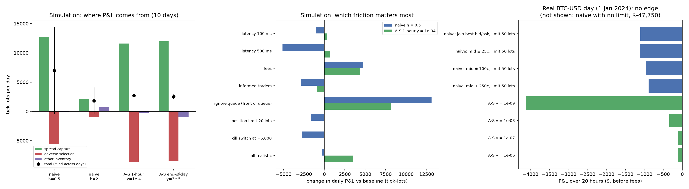
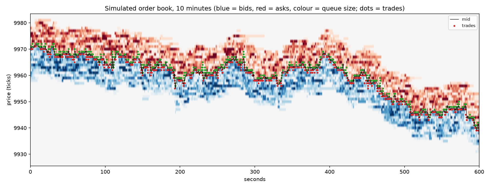
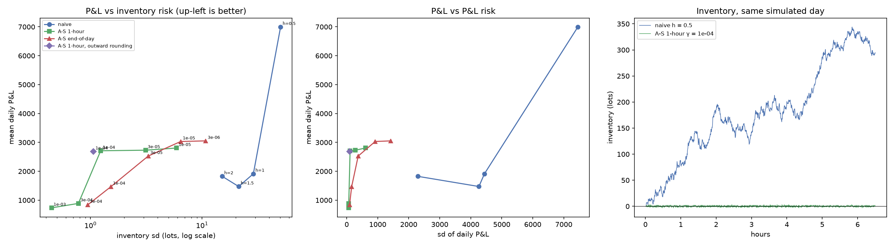
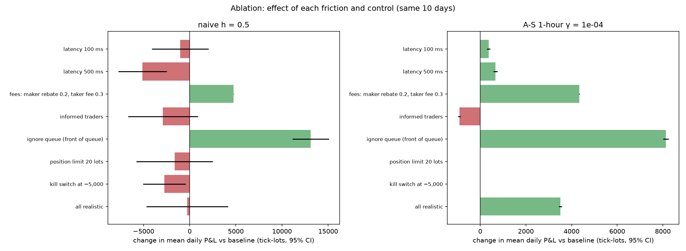

# Limit Order Book Market-Making Simulator

A tested price-time-priority matching engine, an event-driven market simulator, naive and Avellaneda-Stoikov market makers with P&L split into spread capture, adverse selection and inventory, an ablation of real-world frictions, and a replay of a real day of Coinbase BTC-USD order-book data.

## Summary

**Question:** how does a market maker earn and lose money, and what decides whether it survives realistic frictions?

**Method:**
- **Exchange:** a matching engine with first-in-first-out queues, tested against a brute-force reference engine.
- **Market:** an event-driven simulator with random order flow in the style of Cont, Stoikov & Talreja (2010).
- **Strategies:** market makers whose fills come only from their real place in the queue, so a quote that the price merely touches is not filled.
- **Avellaneda-Stoikov:** calibrated on separate simulated days, then compared with a naive fixed-spread maker on the same days.
- **Frictions:** latency, fees, informed traders, position limits and a kill switch, each switched on alone and all together.
- **Real data:** both strategies replayed on a real day of BTC-USD order-book data.

**Headline results:**
- **Inventory control:** Avellaneda-Stoikov cuts inventory risk by about 40× (inventory sd 50 → 1.2 lots) and earns more than every naive setting with similar P&L. The tightest naive maker earns more but swings 70× more from day to day.
- **Queue position is the biggest modelling decision.** Ignoring it (a "fill when the price touches" simulator) overstates daily P&L by 3–4× in the simulation.
- **On the real BTC-USD day, no strategy makes money, even before fees.** The best is Avellaneda-Stoikov at −$104 over 20 hours. In that fast, small-tick market, adverse selection outweighs the spread captured, and queue position hardly matters.

**Main limitation:**
- **The simulated flow has no memory:** no volatility clustering, no persistent order flow.
- **The real-data replay can't show our own market impact,** and covers one day of one asset.



## Method

```mermaid
flowchart LR
    A[book.py<br/>matching engine<br/>FIFO, O(1) cancel] --> B[sim.py<br/>event loop +<br/>random order flow]
    B --> C[agents.py<br/>naive / Avellaneda-Stoikov<br/>+ frictions & controls]
    I[informed.py<br/>informed traders] --> B
    C --> D[P&L attribution<br/>spread · adverse selection ·<br/>inventory · fees]
    E[calibrate.py<br/>σ², fill intensity A, k] --> C
    F[Tardis.dev real data<br/>BTC-USD 1 Jan 2024] --> G[replay.py<br/>Numba replay,<br/>queue-position models]
```

**Matching engine (Phase 1):**
- **Prices:** whole-number ticks.
- **Price levels:** one dict per level, so orders stay in arrival order and a cancel takes O(1).
- **Best price:** a heap per side, with emptied levels removed lazily.
- **Order types:** limit, market, cancel, post-only and immediate-or-cancel.

**Order flow (Phase 2):**
- **Limit orders:** arrive at random times, placed i ticks from the opposite best price at a rate of 1.92/i^0.52 per second.
- **Market orders:** 1 per second per side.
- **Cancels:** each order has its own random cancellation clock.

**Market makers (Phases 3–5):**
- **Quoting:** post-only quotes, re-checked every 0.1 s and left in place, keeping their queue position, when unchanged.
- **Avellaneda-Stoikov:** reservation price r = s − q·γ·σ²·τ, total spread = γσ²τ + (2/γ)·ln(1 + γ/k).
- **Calibration:** σ² from mid-price changes; A and k by fitting ln(fill rate) = ln A − k·δ to probe quotes (R² = 0.997).

**P&L attribution:**
- **Spread capture:** q·(mid before the fill − fill price).
- **Adverse selection:** q·(mid 10 s later − mid before the fill).
- **Fees:** rebates received minus fees paid.
- **Other inventory P&L:** the rest.
- **Check:** the four add up exactly to total P&L, and a test verifies this.

**Real-data replay (Phase 6):**
- **Book:** rebuilt from 35 million price-level updates.
- **Our quotes:** virtual; they never enter the recorded book.
- **Queue position:** estimated with a pessimistic and a proportional model.
- **Trade-throughs:** a trade printing through our price fills us in full.

## Results

| Phase | Result |
|---|---|
| [1. Matching engine](reports/phase1_engine.md) | Identical trades and book to a brute-force reference engine on 400 auto-generated sequences and 130,000 random events; invariants hold after every event; two planted bugs caught. About 540,000 orders/s in plain Python. |
| [2. Order flow](reports/phase2_flow.md) | Reproduces the mechanical facts of real books (spread mostly 1 tick, never empty, depth hump, short-term mean reversion, diffusion) but not the behavioural ones (fat tails, volatility clustering, persistent order flow). |
| [3. Naive maker](reports/phase3_naive.md) | Earns a steady +12,700 tick-lots/day of spread, but inventory wanders like a random walk (up to 180 lots) and drives P&L swings of ±7,500 a day. |
| [4. Avellaneda-Stoikov](reports/phase4_avellaneda_stoikov.md) | At γ = 1e-04: +2,711 ± 109 a day with inventory sd 1.2 lots, beating naive settings of similar P&L. Rounding quotes outward (the guide's code) or inward changes fills 3.4×. The end-of-day horizon loses inventory control at the close. |
| [5. Realism](reports/phase5_realism.md) | Ignoring queue position: +13,115 (naive) / +8,135 (A-S) a day too optimistic. Informed traders: fills keep losing value for minutes. Latency 500 ms costs naive 5,110 a day. A 20-lot position limit cuts naive's worst drawdown from −29,164 to −976. |
| [6. Real BTC-USD day](reports/phase6_real_data.md) | No edge even before fees; A-S −$104 vs naive −$1,103 with a limit; no-limit naive ends 41 BTC short (−$47,750) on a +4.6% trend day. |
| [Benchmarks](reports/benchmarks.md) | Engine ~540,000 orders/s; simulator ~145,000 events/s (both plain Python); real-data replay ~47 million events/s (Numba, 200× the same loop in plain Python). |





## Validation

- **59 unit tests** (`pytest`), covering:
  - every engine rule;
  - hypothesis property tests and seeded stress tests against a naive reference engine (book never crossed, quantity conserved, FIFO kept);
  - the simulator's arrival rates and cancellation clocks;
  - no fill on touch;
  - the P&L attribution adding up exactly;
  - the Avellaneda-Stoikov formulas against the guide's own code;
  - calibration recovering known parameters;
  - each friction (stale quotes picked off under latency, kill switch flattening in pieces);
  - the replay's queue logic on hand-made streams.
- **Regression:** with every friction off, the Phase 5 code reproduces the recorded Phase 4 results exactly.
- **Out-of-sample calibration:** Avellaneda-Stoikov is calibrated on different simulated days from the evaluation days; on the real data, on 00:00–04:00 and evaluated on 04:00–24:00.
- **Paired comparisons:** every strategy and friction runs on the same simulated days.
- **Diagnostics behind every claim:** markouts at several horizons, fills that moved the mid, re-quotes per fill. Explanations are labelled as supported by the data, not proven.

## Limitations

- **Simulated order flow is zero-intelligence:** every order is independent, so there are no fat tails, volatility clustering or persistent order flow. Real adverse selection and inventory risk are worse; informed traders (Phase 5) close part of the gap.
- **No competing fast market makers:** this is why latency even *helps* Avellaneda-Stoikov in Phase 5. In real markets, competitors picking off stale quotes are the main cost of latency.
- **Real-data replay:**
  - our quotes don't affect the book or other traders, so real fills would be somewhat worse;
  - queue position is estimated from price-level data;
  - it covers one day of one asset in a trending regime.
- **Free order-level equity data (LOBSTER) wasn't available without a manual request,** so the real-data test uses crypto. Crypto is a small-tick market, which is very different from the large-tick simulation.
- **Avellaneda-Stoikov ignores queues and its own price impact.** The measured gap between its theory and simulated results (Phase 4) comes from exactly those effects.

## Reproducibility

```bash
make all         # tests + every phase + benchmarks + summary figure (downloads ~400 MB of free data the first time)
make sim         # tests + simulation phases 1-5 only (offline)
make fetch-real  # just download and checksum-verify the real data
```

- **Dependencies:** pinned in `requirements.txt`. Python 3.13.
- **Seeds:** every simulation uses a fixed seed; informed traders use their own random stream.
- **Real data:** from public URLs, checked against recorded SHA-256 hashes, and kept out of git.
- **CI:** `.github/workflows/ci.yml` runs the tests and `make all`.

```
src/lob/   book (engine), sim (event loop, flow), agents (market makers), informed, calibrate, replay (real data)
scripts/   run_phase1.py … run_phase6.py, benchmark.py, make_summary_figure.py
tests/     unit, property and stress tests per module (reference.py: brute-force engine for comparison)
reports/   one report per phase + benchmarks     figures/   every figure
```

**Units:**
- **Simulation:** prices in ticks, sizes in lots, P&L in tick-lots (1 tick-lot = $1 with a $0.01 tick and 100-share lots).
- **Real data:** prices in cents, sizes in BTC, P&L in dollars.

## References

- Avellaneda & Stoikov (2008), *High-frequency trading in a limit order book*, Quantitative Finance 8(3).
- Cont, Stoikov & Talreja (2010), *A Stochastic Model for Order Book Dynamics*, Operations Research 58(3).
- Cont (2001), *Empirical properties of asset returns: stylized facts and statistical issues*, Quantitative Finance 1(2).
- Bouchaud, Bonart, Donier & Gould (2018), *Trades, Quotes and Prices*, Cambridge University Press.
- Tardis.dev historical market data (free first-day-of-month datasets): https://tardis.dev
