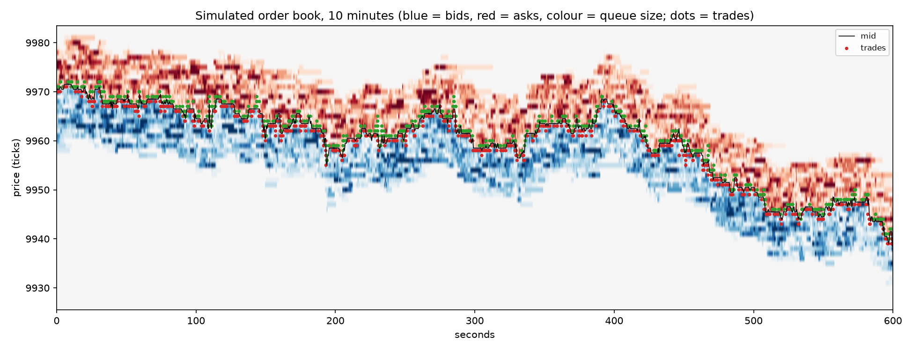
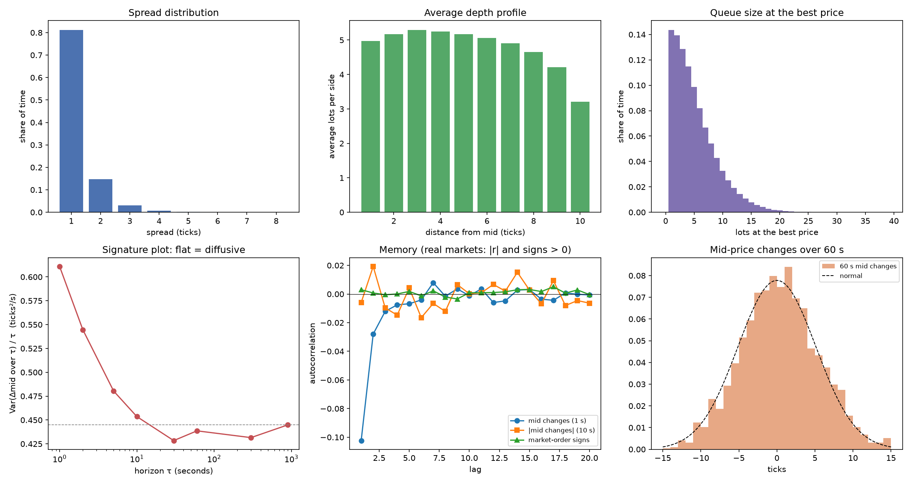

# Phase 2: synthetic order flow

Zero-intelligence order flow in the style of Cont, Stoikov & Talreja (2010): Poisson limit orders placed i ticks from the opposite best price at rate k/i^α, Poisson market orders, and an exponential cancellation clock per resting order. Parameters set the *form* of the model and give a liquid, mostly one-tick-spread book; they are not calibrated to a particular stock.

| Parameter | Value |
|---|---|
| Limit orders per side, distance i = 1..10 ticks from the opposite best | 1.92 / i^0.52 per second (total 9.4/s per side) |
| Market orders per side | 1.0/s |
| Cancellation rate per resting order | 0.6 / i^0.4 per second (by distance at placement) |
| Order size | geometric, mean 2.0 lots |

Simulated: 5 days × 6.5 hours, 4,634,164 events in 33.9 s (**136,779 events/s** including flow generation). Book sampled every second.

## 1. Does it look like a real book? Stylised facts

| Stylised fact (real markets) | This simulator | Reproduced? |
|---|---|---|
| Liquid large-tick stocks: spread is one tick most of the time | 1 tick 81%, 2 ticks 15%, 3+ ticks 4% of the time | yes |
| Book never empty on liquid names | one side empty 0.00% of the time | yes |
| Average depth is hump-shaped: largest a few ticks from the best, not at the best | largest at 3 ticks from the mid (5.3 lots vs 5.0 at 1 tick) | yes (mild) |
| Mid-price diffusive over longer horizons: variance grows linearly with time | variance per second 0.439 at 1 min, 0.445 at 15 min (ticks²/s) | yes |
| Short-horizon mean reversion: consecutive mid changes negatively correlated | lag-1 autocorrelation of 1-second mid changes -0.102 | yes |
| Fat tails at short horizons (kurtosis > 0, excess) | excess kurtosis 0.7 at 10 s, 0.1 at 60 s | no |
| Volatility clustering: autocorrelation of absolute returns positive and slowly decaying | lag-1 -0.006, lag-10 +0.000 (10-second returns) | no |
| Order-flow persistence: signs of successive market orders strongly positively autocorrelated (long memory) | lag-1 +0.003, lag-10 +0.001 | no |
| Trades cluster in time (inter-trade times more variable than Poisson, CV > 1) | coefficient of variation 1.00 | no (CV ≈ 1: Poisson) |

The model reproduces the **mechanical** facts that come from how an order book works (tight spread, never empty, a depth hump, short-term mean reversion, diffusion at longer horizons) and misses the **behavioural** facts that come from how traders act (volatility clustering, persistent order flow, clustered trading). That is the known limit of zero-intelligence models: every order is independent, so nothing can create memory. For testing a market maker this matters: real order flow is more persistent, so real adverse selection and inventory risk are worse than here. Phase 5 adds informed traders to close part of that gap, and Phase 6 replays real order flow.

## 2. Scale

Daily mid-price volatility: 102 ticks over 6.5 hours (from the diffusion rate at 15 minutes, 0.445 ticks²/s). With a tick of $0.01 on a $100 stock (10,000 ticks) that is about 1.0% a day, i.e. roughly 16% annualised: within the range of real large-cap stocks. Median best-queue size 4 lots; 70,231 fills per day.

## 3. Figures

