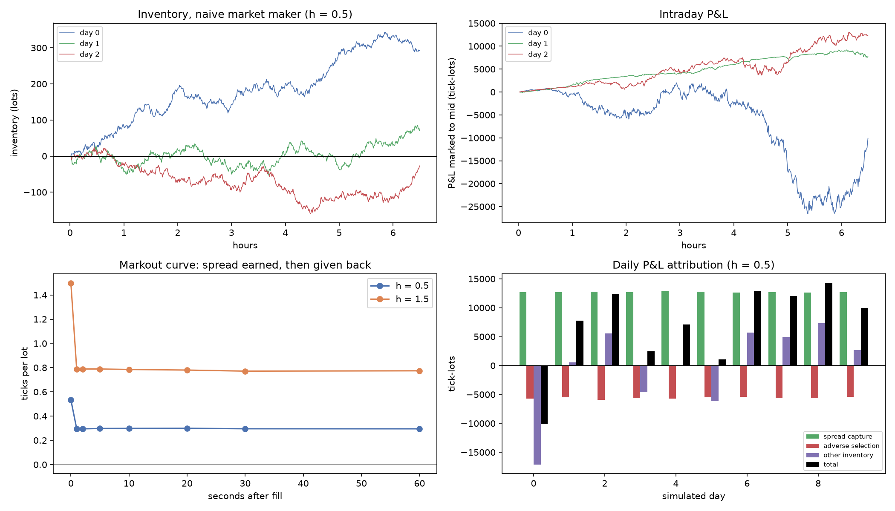

# Phase 3: naive market maker

Fixed symmetric quotes: bid at mid − h, ask at mid + h (rounded outward to ticks), 1 lot each side, post-only, re-checked every 0.1 s and left untouched (keeping queue priority) when the price is unchanged. No inventory control. Fills only when the engine matches the order in its queue. 10 simulated days of 6.5 hours on the Phase 2 order flow, same seeds for both settings. P&L in **tick-lots** (1 tick × 1 lot; with a $0.01 tick and 100-share lots, 1 tick-lot = $1), marked to mid.

## 1. Results per day (mean ± standard deviation across days)

| h (ticks) | Total P&L | Spread capture | Adverse selection (10 s) | Other inventory P&L | Lots filled | Inventory sd | Max \|inventory\| | Inventory at close |
|---|---|---|---|---|---|---|---|---|
| 0.5 | **+6,994 ± 7,454** | +12,720 ± 73 | -5,606 ± 161 | -120 ± 7,462 | 23,829 | 51 | 180 | 119 |
| 1.5 | **+1,473 ± 4,264** | +4,944 ± 70 | -2,355 ± 146 | -1,115 ± 4,233 | 3,299 | 21 | 75 | 59 |

For h = 0.5 the mean daily P&L is +6,994 with t = +3.0 over 10 days. Spread capture alone averages 12,720 a day (0.53 ticks per lot, i.e. about half a one-tick spread), but the inventory terms swing by far more: the standard deviation of daily P&L is 7,454, driven by the inventory term (sd 7,476).

**The inventory problem:** with no control, inventory wanders like a random walk (typical size 51 lots, up to 180), and the day's P&L then depends on which way the price happened to move while it was held. The market maker becomes a directional trader by accident. Avellaneda-Stoikov (Phase 4) attacks exactly this.

## 2. Markouts: what a fill is worth after it happens

Average P&L per lot filled, measured as q × (mid at t + h − fill price). At h = 0 it is the half-spread captured; as h grows the mid moves against the fill (adverse selection) and the value decays.

| h (ticks) | +0 s | +1 s | +2 s | +5 s | +10 s | +20 s | +30 s | +60 s |
|---|---|---|---|---|---|---|---|---|
| 0.5 | +0.534 | +0.295 | +0.295 | +0.298 | +0.299 | +0.299 | +0.296 | +0.295 |
| 1.5 | +1.499 | +0.787 | +0.788 | +0.789 | +0.785 | +0.780 | +0.771 | +0.774 |

The drop happens within one second and then the curve is flat. In this order flow adverse selection is purely **mechanical**: our fill often takes the last lot at a price level, which itself moves the mid. Nobody here trades on information, so there is no further drift after the fill. Real markets also have informed flow, which makes markouts keep falling over seconds to minutes; Phase 5 adds informed traders to measure that.

## 3. Figures

