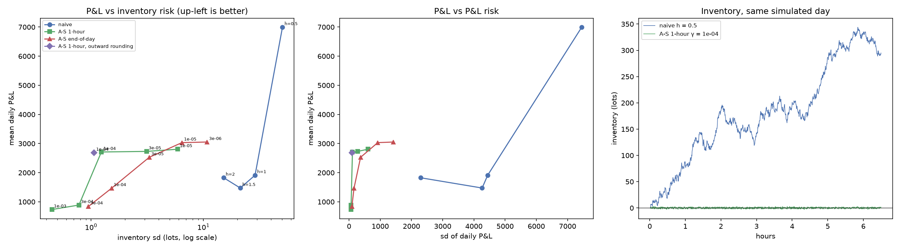
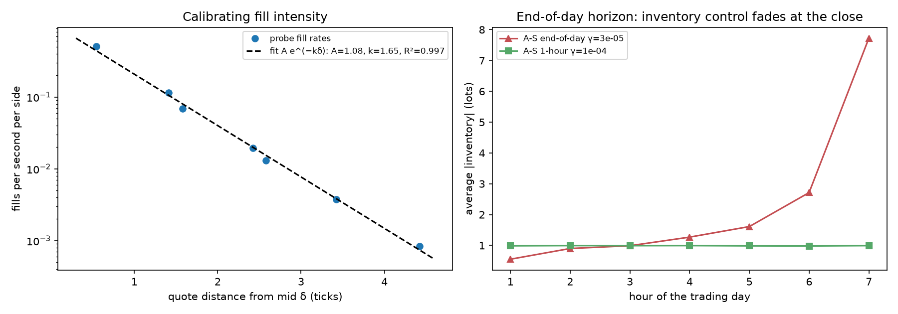

# Phase 4: Avellaneda-Stoikov quotes

Avellaneda & Stoikov (2008): reservation price r = s − q·γ·σ²·τ and total spread γσ²τ + (2/γ)·ln(1 + γ/k), quotes kept passive. Two horizons: **end-of-day** (τ = T − t, as in the paper and the guide) and a **constant 1-hour** τ (a common practical variant, see section 4). Calibration uses separate simulated days (seeds 100–104); evaluation uses the same 10 days as Phase 3 (seeds 0–9) for every strategy, so comparisons are paired day by day.

## 1. Calibration

**Fill intensity.** A 1-lot probe quotes both sides at a fixed distance from the mid (Phase 3's naive maker with half-spread h), 2 hours × 2 seeds per distance; fills per second per side:

| Probe h | Realised mean distance (ticks) | Fills per second per side |
|---|---|---|
| 0.5 | 0.54 | 0.5072 |
| 1 | 1.41 | 0.1146 |
| 1.5 | 1.58 | 0.0690 |
| 2 | 2.42 | 0.0194 |
| 2.5 | 2.58 | 0.0131 |
| 3 | 3.42 | 0.0037 |
| 4 | 4.42 | 0.0008 |

Fit of ln λ = ln A − k·δ: **A = 1.08 fills/s, k = 1.65 per tick, R² = 0.997**: the exponential decay A-S assumes fits this market closely. (Realised distances exceed h because quotes are rounded outward to whole ticks around a half-tick mid.)

**Volatility.** σ² = **0.441 ticks² per second**, from 5-minute mid changes on 3 calibration days (long enough to be diffusive; Phase 2's signature plot).

**What it implies.** For small γ the optimal half-spread is (1/γ)·ln(1 + γ/k) → 1/k = 0.61 ticks. In a market whose spread is usually one tick, the guide's code starter (bid rounded down, ask up) turns that into 1.5 ticks, one level behind the best price, where fills are about 7× rarer; rounding to the nearest tick gives 0.5, i.e. joining the best price. The main runs use nearest rounding; the guide's rounding is shown for comparison (section 3). This was decided from the calibration days, before any evaluation run.

## 2. Results: same 10 days for every strategy

P&L in tick-lots per day (1 tick × 1 lot; $1 with a $0.01 tick and 100-share lots).

| Strategy | Setting | Mean P&L ± sd | P&L / sd | Spread capture | Adverse selection (10 s) | Lots filled | Inventory sd | Max \|inv\| | \|inv\| at close |
|---|---|---|---|---|---|---|---|---|---|
| naive | h = 0.5 | +6,994 ± 7,454 | 0.9 | +12,720 | -5,606 | 23,829 | 50.5 | 180 | 118.6 |
| naive | h = 1 | +1,914 ± 4,442 | 0.4 | +6,694 | -2,919 | 5,483 | 28.8 | 91 | 70.8 |
| naive | h = 1.5 | +1,473 ± 4,264 | 0.3 | +4,944 | -2,355 | 3,299 | 21.3 | 75 | 58.8 |
| naive | h = 2 | +1,826 ± 2,290 | 0.8 | +2,081 | -957 | 953 | 15.1 | 49 | 35.8 |
| A-S 1-hour | γ = 1e-05 | +2,806 ± 603 | 4.6 | +12,813 | -6,430 | 24,291 | 5.9 | 21 | 7.7 |
| A-S 1-hour | γ = 3e-05 | +2,731 ± 279 | 9.8 | +12,864 | -7,454 | 24,652 | 3.1 | 9 | 3.1 |
| A-S 1-hour | γ = 1e-04 | +2,711 ± 109 | 24.8 | +11,585 | -8,665 | 21,681 | 1.2 | 4 | 1.0 |
| A-S 1-hour | γ = 3e-04 | +889 ± 66 | 13.5 | +10,457 | -9,591 | 19,373 | 0.8 | 3 | 0.5 |
| A-S 1-hour | γ = 1e-03 | +735 ± 66 | 11.1 | +6,884 | -6,155 | 7,839 | 0.4 | 2 | 0.2 |
| A-S end-of-day | γ = 3e-06 | +3,053 ± 1,424 | 2.1 | +12,804 | -6,414 | 24,250 | 10.8 | 52 | 34.2 |
| A-S end-of-day | γ = 1e-05 | +3,032 ± 919 | 3.3 | +12,758 | -7,378 | 24,350 | 6.4 | 41 | 24.9 |
| A-S end-of-day | γ = 3e-05 | +2,528 ± 370 | 6.8 | +11,980 | -8,529 | 22,712 | 3.3 | 27 | 16.8 |
| A-S end-of-day | γ = 1e-04 | +1,469 ± 159 | 9.2 | +10,118 | -8,419 | 17,686 | 1.5 | 15 | 11.7 |
| A-S end-of-day | γ = 3e-04 | +840 ± 92 | 9.2 | +6,976 | -6,080 | 9,656 | 0.9 | 13 | 10.6 |
| A-S 1-hour, outward rounding | γ = 1e-04 | +2,685 ± 99 | 27.2 | +6,859 | -3,942 | 6,406 | 1.1 | 4 | 0.6 |

## 3. Does A-S beat naive on inventory risk at similar P&L? (the guide's test)

For each naive setting: the A-S setting with the lowest inventory risk among those earning at least as much on the same days (paired difference ± standard error over 10 days).

| Naive setting | Naive P&L | Best A-S at ≥ that P&L | A-S P&L | Paired P&L diff | Inventory sd: naive → A-S | Daily P&L sd: naive → A-S |
|---|---|---|---|---|---|---|
| h = 0.5 | +6,994 | A-S end-of-day, γ = 3e-06 (none earns as much; highest-earning A-S shown) | +3,053 | -3,942 ± 2,335 | 50.5 → 10.8 | 7,454 → 1,424 |
| h = 1 | +1,914 | A-S 1-hour, γ = 1e-04 | +2,711 | +796 ± 1,434 | 28.8 → 1.2 | 4,442 → 109 |
| h = 1.5 | +1,473 | A-S 1-hour, γ = 1e-04 | +2,711 | +1,237 ± 1,367 | 21.3 → 1.2 | 4,264 → 109 |
| h = 2 | +1,826 | A-S 1-hour, γ = 1e-04 | +2,711 | +885 ± 750 | 15.1 → 1.2 | 2,290 → 109 |

**Against naive settings that earn 1,500–1,900 a day (h = 1 to 2), the test is met with room to spare:** A-S earns more with a small fraction of the inventory risk. **Against the tightest naive maker (h = 0.5) it is not:** no A-S setting matches its ~7,000 a day; A-S gives up roughly 4,000 a day for inventory control, although on a risk-adjusted basis (P&L / sd, section 2) it is far ahead. Section 4 explains where the gap comes from.

**Rounding changes behaviour, not P&L, here:** at γ = 1e-04, the guide's outward rounding fills 6,406 lots a day against 21,681 with nearest rounding (it quotes one level back most of the time) yet earns about the same (+2,685 vs +2,711): fewer fills, each worth more.

## 4. Why A-S earns less than the tightest naive maker

Both quote mostly at the best prices and capture almost the same half-spread at the moment of the fill. The difference is what happens next:

| Strategy | Value per lot at fill | +1 s | +10 s | +60 s | +5 min | Fills where our order was last at its price (fill moved the mid) | Re-quotes per fill |
|---|---|---|---|---|---|---|---|
| naive h = 0.5 | +0.534 | +0.295 | +0.299 | +0.295 | +0.311 | 39% | 0.35 |
| A-S 1-hour, γ = 1e-05 | +0.527 | +0.276 | +0.263 | +0.206 | +0.137 | 40% | 0.33 |
| A-S 1-hour, γ = 1e-04 | +0.534 | +0.193 | +0.135 | +0.126 | +0.128 | 42% | 0.77 |
| A-S 1-hour, γ = 1e-03 | +0.878 | +0.083 | +0.093 | +0.093 | +0.091 | 66% | 4.05 |

The two kinds of strategy capture the same half-spread at the moment of the fill (+0.53); the difference is how much of it survives. Two effects show up, and how much each matters depends on γ:

- **Losing queue position (clear at high γ).** A-S moves its quotes whenever its inventory changes. Each move sends the order to the back of the queue, and orders at the back tend to fill just as the level is used up and the mid moves. At γ = 1e-03, A-S re-quotes 4 times per fill and two-thirds of its fills move the mid (naive: 0.35 and 39%), and almost all of each fill's value is gone within a second. At γ = 1e-04 the effect is small (42% vs 39%), and at γ = 1e-05 it is absent: queue position alone does not explain those settings.
- **Paying to unload inventory (the intended mechanism).** Skewing means moving quotes towards where the market will take them: when long, A-S lowers its ask, often posting alone at a better price than the rest of the book, which itself shifts the mid. Part of the "spread captured" at the fill is measured against a mid that A-S's own quote created, and it is given back as the book refills. At γ = 1e-05 this shows as value decaying over one to five minutes (+0.26 → +0.14) while queue measures match the naive maker. This price concession is what inventory control costs; the continuous A-S model assumes quotes don't move the price and so does not count it.

These are the explanations the measurements support, not a full proof: Phase 5 measures queue position directly and separates the two.

## 5. The end-of-day horizon problem

With τ = T − t the inventory penalty γσ²τ shrinks to zero at the close, so the end-of-day version stops managing inventory exactly when a desk most wants to be flat. Average |inventory| by hour of the day:

| Hour | 1 | 2 | 3 | 4 | 5 | 6 | 7 |
|---|---|---|---|---|---|---|---|
| A-S end-of-day, γ = 3e-05 | 0.6 | 0.9 | 1.0 | 1.3 | 1.6 | 2.7 | 7.7 |
| A-S 1-hour, γ = 1e-04 | 1.0 | 1.0 | 1.0 | 1.0 | 1.0 | 1.0 | 1.0 |

The paper assumes inventory is simply valued at the mid at T; a real desk would add a closing penalty or flatten before the close. The constant-horizon variant avoids the problem.

## 6. Figures

