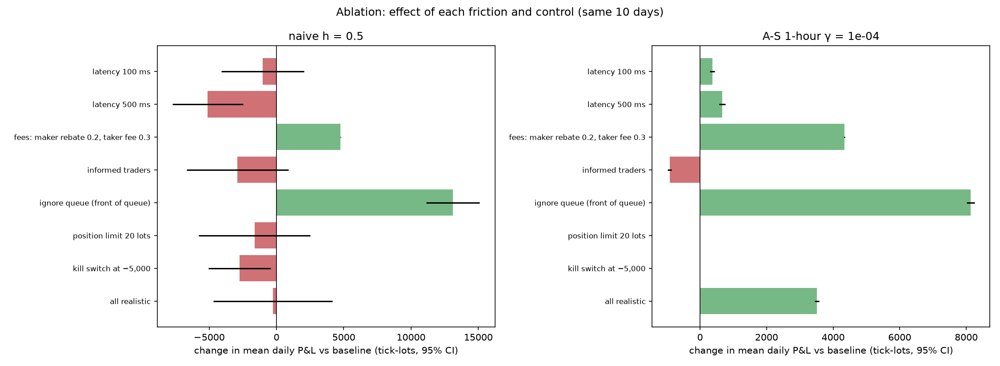
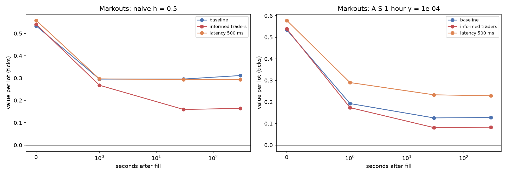

# Phase 5: realism: which friction hurts most?

Two strategies from Phase 4 (naive h = 0.5; A-S with a 1-hour horizon, γ = 1e-04), each run on the same 10 simulated days in 9 environments: the Phase 4 baseline, each friction alone, the risk controls, a counterfactual that ignores queue position, and everything realistic together. With every option off, the code reproduces the recorded Phase 4 results exactly (checked on full days for both strategies). P&L in tick-lots per day; paired differences are against the baseline on the same days.

| Setting | Model |
|---|---|
| Latency | Every cancel and new order reaches the book 100 ms (or 500 ms) after the decision; the old quote stays live meanwhile and can be filled |
| Fees | Maker rebate 0.2 ticks per lot filled passively (≈ $0.002/share), taker fee 0.3 per lot taken |
| Informed traders | News moves a hidden fair value 2–6 ticks about every 2 minutes; informed traders send 2-lot market orders toward it (≈ 2 per second) until the mid catches up or 60 s pass |
| Ignore queue | Counterfactual: our orders go to the front of their price level, as a simulator that ignores queues implicitly assumes |
| Position limit | Stop quoting the side that would take \|inventory\| past 20 lots |
| Kill switch | If P&L falls 5,000 below its intraday peak: cancel, flatten with a market order (paying the taker fee), stop for the day |

A-S keeps its Phase 4 calibration (σ², k) in every environment. Informed trading raises volatility, so in those runs its inputs are out of date: the kind of model risk a real desk faces.

## naive h = 0.5

| Environment | Mean P&L ± sd | Change vs baseline (paired ± se) | Spread capture | Fees | Adverse sel. (10 s) | Lots | Inventory sd | Worst intraday drawdown | Markout per lot +1 s → +30 s → +5 min |
|---|---|---|---|---|---|---|---|---|---|
| baseline | +6,994 ± 7,454 | — | +12,720 | +0 | -5,606 | 23,829 | 50.5 | -29,164 | +0.30 → +0.30 → +0.31 |
| latency 100 ms | +5,968 ± 4,391 | -1,026 ± 1,563 | +11,870 | +0 | -5,268 | 22,109 | 47.2 | -26,443 | +0.30 → +0.29 → +0.31 |
| latency 500 ms | +1,885 ± 4,703 | -5,110 ± 1,336 | +9,300 | +0 | -4,356 | 16,653 | 35.6 | -21,318 | +0.30 → +0.29 → +0.29 |
| fees: maker rebate 0.2, taker fee 0.3 | +11,760 ± 7,451 | +4,766 ± 8 | +12,720 | +4,766 | -5,606 | 23,829 | 50.5 | -27,470 | +0.30 → +0.30 → +0.31 |
| informed traders | +4,095 ± 9,737 | -2,900 ± 1,929 | +13,860 | +0 | -9,044 | 25,632 | 64.4 | -43,776 | +0.27 → +0.16 → +0.16 |
| ignore queue (front of queue) | +20,110 ± 8,666 | +13,115 ± 1,011 | +23,662 | +0 | -4,232 | 44,126 | 61.9 | -18,607 | +0.44 → +0.44 → +0.46 |
| position limit 20 lots | +5,361 ± 1,193 | -1,634 ± 2,115 | +12,561 | +0 | -5,705 | 23,507 | 11.1 | -976 | +0.29 → +0.28 → +0.27 |
| kill switch at −5,000 (6 of 10 days killed) | +4,247 ± 7,294 | -2,747 ± 1,182 | +9,960 | -26 | -4,120 | 19,107 | 37.7 | -4,397 | +0.30 → +0.30 → +0.32 |
| all realistic (latency 100 ms + fees + informed + limit + kill) | +6,718 ± 1,200 | -277 ± 2,257 | +12,551 | +4,608 | -8,198 | 23,039 | 11.8 | -1,559 | +0.27 → +0.15 → +0.12 |

## A-S 1-hour γ = 1e-04

| Environment | Mean P&L ± sd | Change vs baseline (paired ± se) | Spread capture | Fees | Adverse sel. (10 s) | Lots | Inventory sd | Worst intraday drawdown | Markout per lot +1 s → +30 s → +5 min |
|---|---|---|---|---|---|---|---|---|---|
| baseline | +2,711 ± 109 | — | +11,585 | +0 | -8,665 | 21,681 | 1.2 | -69 | +0.19 → +0.13 → +0.13 |
| latency 100 ms | +3,078 ± 90 | +367 ± 40 | +10,784 | +0 | -7,433 | 19,855 | 1.3 | -50 | +0.23 → +0.15 → +0.16 |
| latency 500 ms | +3,375 ± 106 | +664 ± 46 | +8,516 | +0 | -4,791 | 14,729 | 1.4 | -65 | +0.29 → +0.23 → +0.23 |
| fees: maker rebate 0.2, taker fee 0.3 | +7,047 ± 117 | +4,336 ± 7 | +11,585 | +4,336 | -8,665 | 21,681 | 1.2 | -52 | +0.19 → +0.13 → +0.13 |
| informed traders | +1,795 ± 114 | -915 ± 32 | +12,116 | +0 | -10,117 | 22,482 | 1.3 | -110 | +0.17 → +0.08 → +0.08 |
| ignore queue (front of queue) | +10,845 ± 171 | +8,135 ± 60 | +20,342 | +0 | -9,364 | 36,425 | 1.6 | -52 | +0.36 → +0.30 → +0.30 |
| position limit 20 lots | +2,711 ± 109 | +0 ± 0 | +11,585 | +0 | -8,665 | 21,681 | 1.2 | -69 | +0.19 → +0.13 → +0.13 |
| kill switch at −5,000 | +2,711 ± 109 | +0 ± 0 | +11,585 | +0 | -8,665 | 21,681 | 1.2 | -69 | +0.19 → +0.13 → +0.13 |
| all realistic (latency 100 ms + fees + informed + limit + kill) | +6,229 ± 98 | +3,518 ± 34 | +11,290 | +4,104 | -8,806 | 20,522 | 1.3 | -55 | +0.21 → +0.10 → +0.11 |

## Which friction hurts most?

Frictions ranked by their effect on mean daily P&L (paired with the baseline):

| Rank | naive h = 0.5 | A-S 1-hour γ = 1e-04 |
|---|---|---|
| 1 | latency 500 ms: -5,110 ± 1,336 | informed traders: -915 ± 32 |
| 2 | informed traders: -2,900 ± 1,929 | latency 100 ms: +367 ± 40 |
| 3 | latency 100 ms: -1,026 ± 1,563 | latency 500 ms: +664 ± 46 |
| 4 | fees: maker rebate 0.2, taker fee 0.3: +4,766 ± 8 | fees: maker rebate 0.2, taker fee 0.3: +4,336 ± 7 |

- **Most damaging:** latency 500 ms for the naive maker, informed traders for A-S. Informed traders raise the mid's variance (with the market maker present) from 0.30 to 0.41 ticks² per second, and their effect shows in the markouts: fills keep losing value from 1 s to 5 min, unlike the baseline, where adverse selection is over within a second. For the naive maker these differences are noisy (its daily P&L swings by thousands), so only the 500 ms latency effect is clearly significant; A-S's P&L is so stable that even its smaller effects are.
- **Latency helps A-S here, which needs care.** Its quotes land later, so it chases its own inventory less: fewer re-quotes and fills, each worth more a second later (the Phase 4 finding that eager re-quoting is A-S's main cost). This is *not* a general result: the simulator has no fast competing market makers or arbitrageurs to pick off stale quotes, which is the main way latency costs money in real markets. Here stale quotes can only be hit by random flow and the informed traders.
- **Queue position:** pretending our orders sit at the front of the queue changes daily P&L by +13,115 (naive h = 0.5), +8,135 (A-S 1-hour γ = 1e-04). That is how far a 'fill when the price touches' simulator would mislead.
- **Fees** are a rebate for a passive market maker: they add to P&L in proportion to volume, so they favour the high-volume strategies. They become a cost only when the strategy has to take liquidity (the kill switch).

## Risk controls

| Strategy | Control | Mean P&L change | Inventory sd (baseline → control) | Worst intraday drawdown (baseline → control) | Days killed |
|---|---|---|---|---|---|
| naive h = 0.5 | position limit 20 lots | -1,634 ± 2,115 | 50.5 → 11.1 | -29,164 → -976 | 0 |
| naive h = 0.5 | kill switch at −5,000 | -2,747 ± 1,182 | 50.5 → 37.7 | -29,164 → -4,397 | 6 |
| A-S 1-hour γ = 1e-04 | position limit 20 lots | +0 ± 0 | 1.2 → 1.2 | -69 → -69 | 0 |
| A-S 1-hour γ = 1e-04 | kill switch at −5,000 | +0 ± 0 | 1.2 → 1.2 | -69 → -69 | 0 |

## All frictions together

- **naive h = 0.5:** +6,994 a day in the idealised baseline → **+6,718 ± 1,200** with every friction and control on, of which +4,608 is net fees (mostly maker rebates); **+2,110 without them**.
- **A-S 1-hour γ = 1e-04:** +2,711 a day in the idealised baseline → **+6,229 ± 98** with every friction and control on, of which +4,104 is net fees (mostly maker rebates); **+2,124 without them**.

Maker rebates are worth as much as or more than the whole trading profit here: a market maker in this setting is largely paid by the exchange for providing liquidity, which is close to how many real ones operate.

## Figures

