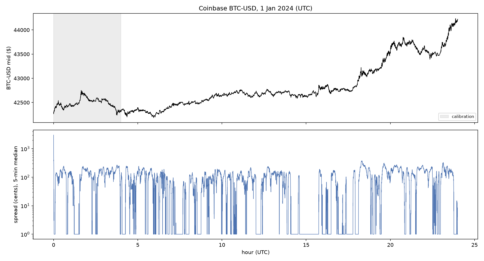
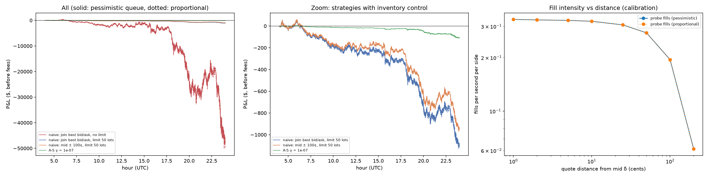

# Phase 6 (stretch): replaying a real day of order-book data

**Data:** Coinbase BTC-USD, 1 January 2024 (UTC), from Tardis.dev's free first-day-of-the-month datasets (no account needed): every change to each price level's total size and every trade, timestamped to the microsecond. 35,021,449 book updates (starting with a full 27,069-level snapshot) and 185,058 trades. Files and SHA-256 checksums:

- `incremental_book_L2_BTC-USD_2024-01-01.csv.gz`: https://datasets.tardis.dev/v1/coinbase/incremental_book_L2/2024/01/01/BTC-USD.csv.gz (`49618c2885cd6aa9…`, verified)
- `trades_BTC-USD_2024-01-01.csv.gz`: https://datasets.tardis.dev/v1/coinbase/trades/2024/01/01/BTC-USD.csv.gz (`7a95f20fc40d5a6c…`, verified)

**How the replay works.** The recorded book is rebuilt event by event (Numba-compiled, about 100 million events per second, so the day takes under a second). Our quotes are **virtual**: they never enter the recorded book, so the replay cannot show our own market impact, as the guide warns. Price-level data does not say where in a queue each order sits, so our queue position is estimated with two standard models that bracket the truth: **pessimistic** (we join the back; only trades move us up) and **proportional** (cancels are spread evenly over the queue). A trade printing at a worse price than our quote means the price went through us and fills us in full.

Quotes are 0.01 BTC (one "lot"), re-evaluated every 100 ms. Calibration uses 00:00–04:00 UTC; everything is evaluated on 04:00–24:00 only.

## 1. The market: very unlike the simulation

| | Simulation (Phase 2) | Real BTC-USD, 1 Jan 2024 |
|---|---|---|
| Spread | 1 tick 81% of the time | 1 cent 43% of the time; median 79 cents; 90th percentile 342 cents |
| Mid volatility | 0.44 ticks² per second | 51,735 cents² per second (≈ $2.27 per second: about 227 ticks) |
| Price over the day | random walk | $42,296 → $44,222 (+4.6%): a trending day |
| Size at the best price | ~4 lots | median 0.115 BTC (bid), 0.117 BTC (ask) |
| Data quality | — | reconstructed book crossed or one-sided on 0.023% of events |

BTC-USD is a **small-tick** market: a one-cent tick is tiny next to a move of hundreds of ticks per second. The spread flips between one cent (a crowded queue) and dollars wide, and the price can move far before a market maker can earn back a loss. Our simulation was a large-tick world.

## 2. Calibration on 00:00–04:00

σ² = **51,735 cents²/s** (1-minute mid changes). Fill intensity from virtual probes quoting at a fixed distance δ from the mid (all at once: virtual orders do not interact):

| δ (cents) | fills/s per side (pessimistic) | fills/s per side (proportional) |
|---|---|---|
| 1 | 0.3285 | 0.3288 |
| 2 | 0.3265 | 0.3265 |
| 5 | 0.3243 | 0.3244 |
| 10 | 0.3206 | 0.3206 |
| 25 | 0.3060 | 0.3060 |
| 50 | 0.2760 | 0.2760 |
| 100 | 0.1949 | 0.1950 |
| 200 | 0.0613 | 0.0613 |

- pessimistic: A = 0.359 fills/s, k = 0.0081 per cent (1/k = 123 cents), R² = 0.957
- proportional: A = 0.359 fills/s, k = 0.0081 per cent (1/k = 123 cents), R² = 0.957

The exponential law fits less well than in the simulation (R² 0.96 vs 0.997): fill rates barely change for δ up to about 25 cents, likely because the spread is often wider than that, so such quotes sit inside the spread and are filled at similar rates, then fall off fast. The two queue models give almost the same fill rates, a first sign that queue position matters little here (section 4).

## 3. Results on 04:00–24:00 UTC (20 hours, before fees)

P&L in dollars, marked to the mid at the end. Markouts are value per BTC filled, in dollars: at the fill against the recorded mid just before it (the spread captured), later against the mid 1, 10 and 60 seconds on (interpolated from one-second samples).

**Queue model: pessimistic**

| Strategy | P&L ($) | BTC traded | Break-even maker fee (bp) | Spread capture ($) | Markout per BTC: fill → +1 s → +10 s → +60 s | Inventory sd (BTC) | Max \|inv\| | Inventory at end |
|---|---|---|---|---|---|---|---|---|
| naive: join best bid/ask, no limit | -47,750 | 186.5 | -59.38 | +78 | +0.42 → -1.68 → -1.83 → -1.79 | 11.73 | 41.23 | -41.16 |
| naive: join best bid/ask, limit 50 lots | -1,103 | 145.8 | -1.75 | +60 | +0.41 → -1.78 → -1.86 → -1.49 | 0.04 | 0.50 | -0.42 |
| naive: mid ± 25¢, limit 50 lots | -1,112 | 287.7 | -0.90 | +35 | +0.12 → -0.88 → -0.92 → -0.68 | 0.04 | 0.50 | -0.39 |
| naive: mid ± 100¢, limit 50 lots | -959 | 191.2 | -1.16 | +146 | +0.76 → -0.46 → -0.44 → -0.10 | 0.04 | 0.50 | -0.46 |
| naive: mid ± 250¢, limit 50 lots | -886 | 60.0 | -3.41 | +99 | +1.66 → -0.78 → -0.62 → -0.10 | 0.12 | 0.50 | -0.48 |
| A-S γ = 1e-09 | -4,111 | 217.8 | -4.37 | +201 | +0.92 → -0.33 → -0.22 → +0.38 | 0.64 | 3.65 | -1.48 |
| A-S γ = 1e-08 | -343 | 212.3 | -0.37 | +194 | +0.92 → -0.37 → -0.32 → +0.13 | 0.10 | 0.75 | -0.20 |
| A-S γ = 1e-07 | -110 | 193.3 | -0.13 | +172 | +0.89 → -0.48 → -0.51 → -0.25 | 0.02 | 0.12 | +0.00 |
| A-S γ = 1e-06 | -115 | 123.5 | -0.21 | +102 | +0.83 → -0.87 → -0.90 → -0.91 | 0.01 | 0.04 | -0.00 |

**Queue model: proportional**

| Strategy | P&L ($) | BTC traded | Break-even maker fee (bp) | Spread capture ($) | Markout per BTC: fill → +1 s → +10 s → +60 s | Inventory sd (BTC) | Max \|inv\| | Inventory at end |
|---|---|---|---|---|---|---|---|---|
| naive: join best bid/ask, no limit | -49,636 | 203.7 | -56.53 | +83 | +0.41 → -1.64 → -1.80 → -1.70 | 12.16 | 42.30 | -42.22 |
| naive: join best bid/ask, limit 50 lots | -1,123 | 161.9 | -1.61 | +65 | +0.40 → -1.74 → -1.82 → -1.48 | 0.04 | 0.50 | -0.40 |
| naive: mid ± 25¢, limit 50 lots | -1,112 | 287.7 | -0.90 | +35 | +0.12 → -0.88 → -0.92 → -0.68 | 0.04 | 0.50 | -0.39 |
| naive: mid ± 100¢, limit 50 lots | -955 | 191.2 | -1.16 | +146 | +0.76 → -0.46 → -0.44 → -0.10 | 0.04 | 0.50 | -0.46 |
| naive: mid ± 250¢, limit 50 lots | -885 | 60.0 | -3.41 | +99 | +1.66 → -0.78 → -0.63 → -0.10 | 0.12 | 0.50 | -0.48 |
| A-S γ = 1e-09 | -4,113 | 217.9 | -4.37 | +201 | +0.92 → -0.33 → -0.22 → +0.38 | 0.64 | 3.65 | -1.48 |
| A-S γ = 1e-08 | -343 | 212.3 | -0.37 | +194 | +0.92 → -0.37 → -0.33 → +0.11 | 0.10 | 0.75 | -0.20 |
| A-S γ = 1e-07 | -104 | 193.5 | -0.13 | +173 | +0.89 → -0.49 → -0.52 → -0.22 | 0.02 | 0.12 | +0.00 |
| A-S γ = 1e-06 | -119 | 123.8 | -0.22 | +103 | +0.83 → -0.87 → -0.92 → -0.91 | 0.01 | 0.04 | +0.01 |

## 4. What the real day says

- **No edge, even before fees.** Every strategy loses money over the 20 hours. The best is A-S γ = 1e-07 (proportional queue): −$104 on 193.5 BTC traded, so it would need a maker *rebate* of 0.13 bp just to break even, and the naive makers need 0.9–3.4 bp. A market maker paying any maker fee on this day loses more.
- **Avellaneda-Stoikov is clearly the better approach on real data:** its best setting loses about $107 against $1,113 for naive joining the best prices with a position limit, while keeping inventory near zero. Its skew does what the simulation suggested.
- **Inventory runs away without control:** joining the best prices with no limit ends the day -41 BTC (pessimistic) / -42 BTC (proportional) as BTC trends up; buyers keep lifting the ask. A limit or A-S skew is essential, not optional.
- **Adverse selection is the dominant cost:** on a small-tick, fast-moving market the value of a fill decays within seconds, by far more than the spread captured, which is the guide's warning in its starkest form.
- **Queue position barely matters on this market:** the two queue models agree within $20 for every strategy with inventory control (and within 5% for the runaway one), the opposite of the simulation, where it was the largest effect. The likely reason: with spreads often dollars wide, our quotes frequently sit inside the spread with nobody ahead of them, and in fast moves fills come from the price trading straight through our quote. Queue position matters most on large-tick markets with long queues, like the simulated one.
- **Limits of a replay:** our orders do not affect the book or other traders, so fills on a real exchange would be somewhat worse (we would move prices against ourselves); one day, one asset, one trend regime.

## 5. Figures

